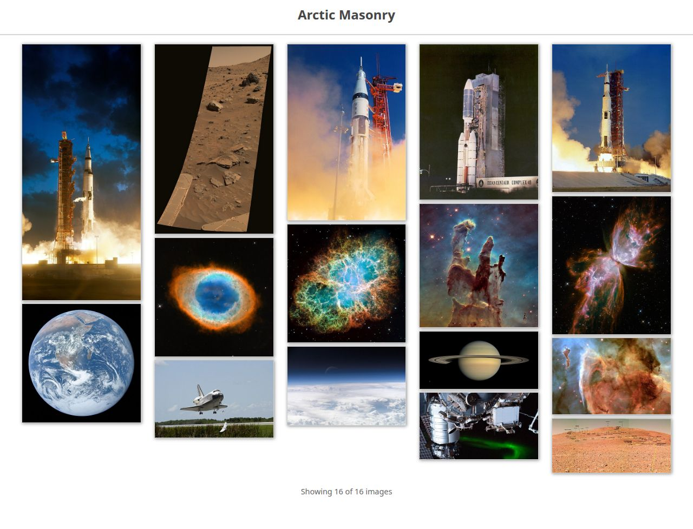

# Arctic Masonry

A small, dependency-free, responsive **masonry layout** as a standalone ES module, with a tiny demo server.



- Columns follow the container width (1 to 10 columns, see [Breakpoints](#options)).
- Each tile goes into the **shortest column**, so columns stay balanced even with very different aspect ratios.
- More images load **when you scroll to the bottom**, and a real **"Load more" button** is always there as a keyboard / screen-reader fallback (with a polite "Showing x of y images" status).
- No dependencies, no globals, no inline handlers or styles (works under a strict CSP). Respects `prefers-reduced-motion`.

Created by Sidharth Patro (sidharth.patro@outlook.com). Modernised for Python 3 / Tornado 6.6 and ES modules in this fork.

## Use it as a module

Copy `static/arctic-masonry.js` and `static/arctic-masonry.css` into your site (no build step, no npm package):

```html
<!-- index.html -->
<link rel="stylesheet" href="arctic-masonry.css">
<main id="main" aria-label="Image gallery"></main>
<script type="module" src="gallery.js"></script>
```

```js
// gallery.js
import { ArcticMasonry } from './arctic-masonry.js';

new ArcticMasonry(document.getElementById('main'), {
  images: [
    { src: 'images/a.jpg', alt: 'A mountain', width: 500, height: 750 },   // width/height give the aspect ratio
    { src: 'images/b.jpg', alt: 'A river',    width: 500, height: 333 },
  ],
  batchSize: 15,
});
```

Keep the script in its own file (as above): the demo server's CSP, like any strict CSP, does not allow inline scripts.

### Options

| Option | Default | Meaning |
|---|---|---|
| `images` | (required) | Array of `{ src, alt, width, height }`. `width`/`height` give the aspect ratio so tiles are laid out before the images load (4:3 is assumed if missing). |
| `batchSize` | `15` | How many images each load step adds. |
| `breakpoints` | `DEFAULT_BREAKPOINTS` | `[[minContainerWidthPx, columns], ...]`; the last entry whose minimum fits wins. Default: 0 → 1, 400 → 2, 700 → 3, 900 → 4, 1100 → 5, 1600 → 6, 1950 → 7, 2200 → 8, 2400 → 9, 2500 → 10. |

### API

`loadMore()` adds the next batch (returns how many were added) · `destroy()` removes everything the instance added · read-only `columnCount`, `loadedCount`, `totalCount`, `hasMore`. The container also gets `data-columns`, `data-loaded` and `data-total` attributes. Named exports: `ArcticMasonry`, `DEFAULT_BREAKPOINTS`, `columnCountFor(width, breakpoints)`, `isSafeImageSrc(src)`.

Image sources must be `http(s):`, `blob:`, `data:image/(png|jpeg|gif|webp|avif)` or relative; anything else (`javascript:`, `data:text/html`, `file:`...) is never set on an `` and the tile is marked `is-error`. Alt text is always inserted as text.

## Run the demo

Requires **Python 3.11 or newer** (Tornado 6.6 needs it; CI tests 3.12, 3.13 and 3.14).

```bash
python -m venv .venv && . .venv/bin/activate
pip install -r requirements.txt
python run.py            # http://localhost:8888
python run.py 9000       # or: PORT=9000 python run.py
```

The server only serves the `static/` directory (gzip on, path traversal and dotfiles refused, security headers on every response).

## Demo images and licences

All 16 demo images are **public domain / CC0** works from Wikimedia Commons (mostly NASA). Attribution for each is in **[CREDITS.md](CREDITS.md)**. `tools/fetch_images.py` (standard library only) regenerates `static/images/`, `static/images.json` and `CREDITS.md`, and **refuses any file whose Commons licence is not Public domain or CC0**:

```bash
python tools/fetch_images.py     # needs network access to commons.wikimedia.org
```

The demo uses a system font stack; no font files are shipped.

## Tests

```bash
pip install -r requirements-dev.txt && pytest                  # server, security headers, demo data
npm ci && npx playwright install chromium firefox
npx playwright test                                            # real browsers: layout, scroll/button loading, CSP
```

pytest covers static serving, gzip, traversal and symlinks, security headers and HSTS, and that `images.json`, the image files and `CREDITS.md` agree. Playwright runs the same suite in **Chromium and Firefox** against the real server: column counts at 500 / 800 / 1280 / 2300 px, no overlapping tiles, every image decodes, zero console errors / failed requests, shortest-column placement, resize re-flow, loading by scroll and by keyboard, and that the CSP is actually enforced.

## Docker

```bash
docker compose up -d --build --wait      # http://localhost:8888  (HOST_PORT=9000 to change)
docker compose down
```

The image runs as an unprivileged user (UID 10001) with a read-only root filesystem, all capabilities dropped, `no-new-privileges` and a healthcheck. CI builds it and runs the Playwright suite against the container.

## Deploying

Put the container (or `python run.py`) **behind a TLS-terminating reverse proxy**; the app itself speaks plain HTTP.

Security headers (CSP `default-src 'none'; script-src 'self'; style-src 'self'; img-src 'self' data:`, nosniff, `no-referrer`, `X-Frame-Options: DENY`, COOP/CORP) are always on. **HSTS is off by default** and is opt-in through environment variables:

| Variable | Effect |
|---|---|
| `HSTS_SECONDS` | Sends `Strict-Transport-Security: max-age=<seconds>`. Unset or `0` = off. |
| `HSTS_INCLUDE_SUBDOMAINS=1` | Adds `includeSubDomains` (only together with `HSTS_SECONDS`). Off by default. |

`preload` is never sent. Start with a short value (for example `300`) and only add `includeSubDomains` when **every** subdomain is served over HTTPS: a long max-age cannot be undone remotely. Both variables are passed through `docker-compose.yml`; with plain Python, export them in the environment (the `.env` file is read by Docker Compose, not by `run.py`). `.env.example` lists them.

If you embed the module in your own page under your own CSP, it needs no inline script and sets styles only through the CSSOM.

## Known issues

- Tile entrance animations are skipped for users with `prefers-reduced-motion`, by design.
- The "Showing x of y" count and alt texts of the demo images come from Commons metadata and are English only.
- Layout is verified by measurement, not by pixel-comparing screenshots.
